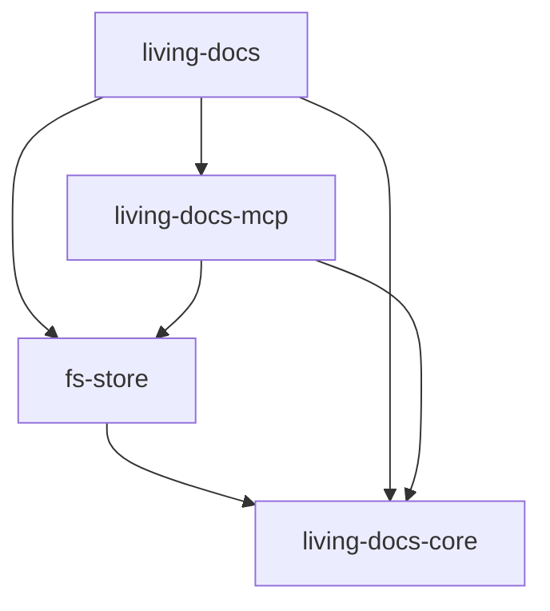

# Crates

The crates of this workspace and the dependencies between them, for a contributor deciding where a change belongs. An arrow points from a crate to a crate it depends on; the diagram is generated from the workspace manifests and never edited by hand.

## Drift instrument

Drift caught by: `bash skills/living-docs/scripts/regen-views.sh --check`, run in `make check`, which fails when the generated region no longer matches `cargo metadata`; between commits the `stale-view` advisory of `living-docs check` flags a changed manifest.

<!-- generated by: bash scripts/crate-graph.sh | inputs: Cargo.toml, */Cargo.toml | sha256: 653a3de8660ee415825126a83d749b74df330c2b7d12be38cbbf68b8fef63972 -->

<!-- end generated -->
