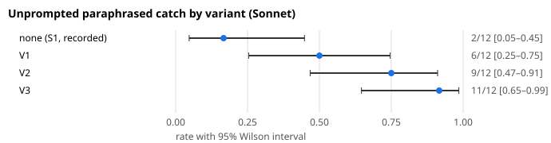
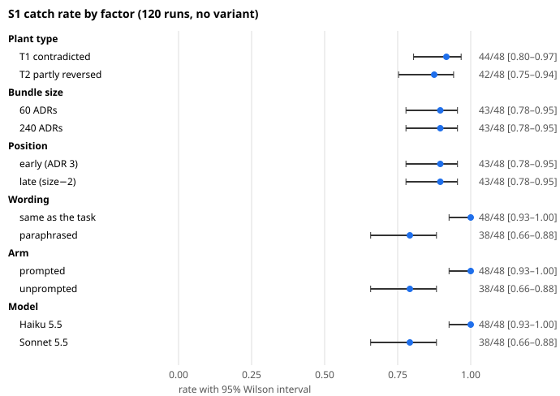
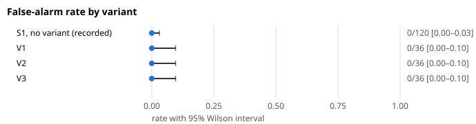

# 0006. How decision-drift catch rates are measured

## Question

How does this project measure whether an agent catches an in-force decision that a new one contradicts, partly reverses, or leaves partly dead, and how much should a measured rate be trusted? Issue 0153 decides features (ADR 0105, ADR 0106) and closes or opens slices on these numbers, so the method must be explicit and the uncertainty stated.

## Method

**Design.** A controlled experiment over generated documentation bundles. The independent variable is the binary under test (a variant: none, V1, V2, V3; later R0, R1, R2). Everything else is held fixed or varied on purpose:

| Factor | Levels | Why |
|---|---|---|
| Plant type | T1 contradicted, T2 partly reversed, x1 exception from another topic, control (none), noise control | the failure kinds of issue 0153's taxonomy, plus a no-conflict baseline |
| Bundle size | 60 and 240 ADRs | the "past 60 records" claim |
| Wording | same as the task, or paraphrased | lexical search finds only the first |
| Position | early (ADR 3) or late (size−2) | recency effects |
| Arm | unprompted (task only), prompted (also asked to list conflicts) | prompted is the ceiling; unprompted is the field case |
| Model | Sonnet 5.5, Haiku 5.5 | model sensitivity |

**Materials.** `evals/scale/generate.sh` and `generate-exceptions.sh` write every scenario from a seed (153) with a Park–Miller generator, so the same seed and sizes give byte-identical bundles. Filler records come from fixed topic tables and share no rare words with the tasks, except in the noise controls, which do on purpose.

**Procedure.** Each run copies a bundle into a fresh git repository, tags the baseline, and gives the task to one model through an isolated runner (`evals/scale/runner.sh`: project settings only, no MCP, no sub-agents, no web). Runs go one at a time, since models write scratch files to fixed paths. Raw transcripts and scores are kept outside the repository (`~/.local/share/living-docs-evals/<slice>/<variant>`).

**Scoring (deterministic, no model).** `expect.sh` inspects the repository after the run, against the baseline tag:
- a catch, unprompted: the plant is newly Superseded by a record added in the run (`outcome: superseded`), or only named by one (`outcome: named`); prompted: the plant's number is listed in `CONFLICTS.txt`;
- a false alarm: any other record newly Superseded, or any other number listed; in a noise control only a supersede counts;
- an over-link: a new record names an in-force record other than the plant (information);
- a kept clause (T2): the plant stays in force, or a record added in the run names the plant's seeded token;
- an exception (x1): the limit the agent writes into a file follows the record in force, not the clause it left dead.

**Metrics.** Catch rate = catches / planted runs; false-alarm rate = runs with a false alarm / scored runs; both per factor level. A run whose setup or runner failed, or whose score holds an unknown line, is excluded and counted.

**Statistics.** Each rate is a binomial proportion reported with a 95% Wilson score interval [1][2], computed by `evals/scale/aggregate.sh` (`catch_ci`, `false_alarm_ci`) and pinned by a test, never by hand. The Wilson interval behaves well at small n and near 0 or 1, where the normal approximation does not. From S9 on, a variant meets a threshold only when the interval's lower bound clears it, and two variants differ only when their intervals do not overlap (a conservative rule; it can miss a real but small difference).

**Pre-registered decision rules.** Each slice fixes its rule in the issue's Decision before any model run [3], and the Outcome applies it as written. A change to a rule after seeing data is recorded as such (it happened once: the noise-control false-alarm definition, owner decision of 2026-11-24, recorded before V3 was measured).

**Sample.** S1: 120 runs (10 scenarios × 2 arms × 2 models × 3). S5: 72 (V1 and V2, Sonnet unprompted, 12 scenarios × 3). S8: 36 (V3, same). From S9: 10 repetitions per scenario.

## Findings

| Finding | Evidence | Confidence |
|---|---|---|
| Unprompted paraphrased catch rose with each variant: none 2/12 [0.05–0.45], V1 6/12 [0.25–0.75], V2 9/12 [0.47–0.91], V3 11/12 [0.65–0.99] | issue 0153 Outcome, S1/S5/S8 | medium: the interval of "none" overlaps neither V2 nor V3 (0.45 below 0.47 and 0.65); adjacent variants overlap |
| Catch did not fall from 60 to 240 ADRs (43/48 each, S1) | issue 0153 Outcome | medium |
| False alarms were 0 in every arm: 0/120 (S1), 0/36 per variant (S5, S6 rescored, S8) [0.00–0.10] | issue 0153 Outcome | high for "rare", not for "never" |
| The runner reads before writing in 120/120 runs against about 16/140 field sessions, so every rate is an upper bound on field behaviour | issue 0149 and 0153 Outcomes | high |
| A scorer can be fooled: one S8 run retired the plant with an unrelated record and counted as a catch until stage 0 required a new successor | issue 0153 Outcome, S9 stage 0 | high |

Each figure is a forest plot: a dot at the rate and a whisker over its 95% Wilson interval, drawn by `evals/scale/plot.sh` from the rows beside it (`figures/*.tsv`). The V1, V2 and V3 rows come from `aggregate.sh` over the raw runs; the S1 rows and the "none" row are the counts recorded in issue 0153's Outcome, since no S1 run directory is kept under `~/.local/share/living-docs-evals`.

## Implications

The method supports deciding between a variant and none; it does not yet separate adjacent variants (V2 against V3) at 12 runs per cell, which is why S9 raises the sample to 10 repetitions per scenario and decides on interval bounds. Rates describe an isolated runner and one seed; they rank variants more reliably than they predict field rates.

Threats to validity, in order of weight: one seed and one plant per cell (construct and external validity); the isolated runner reads more than field sessions do (external); paraphrases written by the experimenters (construct); heuristic markers in the scorer, replaced by seeded tokens where found (measurement); models and their versions drift over time (reproducibility: each Outcome names the binary commit and model).

## Open Questions

- Should several seeds replace more repetitions of one seed, to separate scenario variance from run variance?
- A field sample (real sessions on real bundles) would calibrate how far the upper bound sits from practice.
- Paired designs (the same scenario and seed across variants) would allow McNemar's test instead of comparing independent intervals.

# References

[1] [Wilson, E. B. (1927). Probable inference, the law of succession, and statistical inference. Journal of the American Statistical Association 22(158)](https://doi.org/10.1080/01621459.1927.10502953). Available at: https://doi.org/10.1080/01621459.1927.10502953. Accessed on: 2026-11-24.
[2] [Newcombe, R. G. (1998). Two-sided confidence intervals for the single proportion: comparison of seven methods. Statistics in Medicine 17(8)](https://doi.org/10.1002/(SICI)1097-0258(19980430)17:8%3C857::AID-SIM777%3E3.0.CO;2-E). Available at: https://doi.org/10.1002/(SICI)1097-0258(19980430)17:8%3C857::AID-SIM777%3E3.0.CO;2-E. Accessed on: 2026-11-24.
[3] [Nosek, B. A. et al. (2018). The preregistration revolution. PNAS 115(11)](https://doi.org/10.1073/pnas.1708274114). Available at: https://doi.org/10.1073/pnas.1708274114. Accessed on: 2026-11-24.
