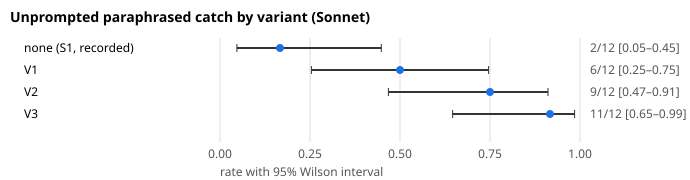

# Evals

A harness that drives an agent through documentation tasks in scratch bundles and reports, per scenario, whether the bundle ended correct and how the CLI was used. It is shell and `jq` outside the binary: no model call lives in the workspace crates, and the model is reached only through a runner command you name.

## Run it

```sh
make build
bash evals/run.sh                       # every scenario, the default runner (claude -p)
bash evals/run.sh record-decision       # one scenario
LIVING_DOCS_EVAL_RUNNER=evals/tests/runners/solve.sh bash evals/run.sh   # the scripted stand-in
```

`run.sh` makes a scratch git repository under `$TMPDIR` per scenario, puts the binary named by `LIVING_DOCS_BIN` (default `target/release/living-docs`) first on `PATH`, runs the scenario's `setup.sh`, pipes `task.md` to the runner with the scratch repository as the working directory, saves the runner's stdout as the transcript, scores the result and prints a table. It exits 0 when every scenario has `check_ok` and `expect_ok`, 1 otherwise, 2 on bad usage.

| Variable | Meaning |
| --- | --- |
| `LIVING_DOCS_BIN` | binary under test |
| `LIVING_DOCS_EVAL_RUNNER` | runner command line; default `claude -p --output-format stream-json --verbose --permission-mode acceptEdits` |
| `LIVING_DOCS_EVAL_OUT` | output directory; default `${XDG_DATA_HOME:-$HOME/.local/share}/living-docs-evals`, outside the repository so that no worktree holds raw run outputs (transcripts can print candidate records); results land in `OUT/RUN_ID/NAME/` |
| `LIVING_DOCS_EVAL_TIMEOUT` | seconds allowed per runner call, default 900 (needs `timeout(1)`) |
| `LIVING_DOCS_EVAL_KEEP` | `1` keeps the scratch directories and records their path in `score.json` |
| `LIVING_DOCS_EVAL_SCENARIOS` | scenarios directory; default `evals/scenarios` |

A runner is any command that reads the task on stdin and writes a Claude Code JSONL transcript on stdout. It also receives `LIVING_DOCS_EVAL_SCENARIO`. A runner path relative to the directory you start from is made absolute before the runner starts. A scenario name must match `[A-Za-z0-9][A-Za-z0-9._-]*` and hold no `..`; anything else is refused with exit 2.

Each scenario directory under `OUT/RUN_ID/` holds `transcript.jsonl`, `runner.stderr`, `setup.log` and `score.json`. A runner that exits non-zero is scored anyway and marked `runner_failed`; the run continues.

## Scenarios

`evals/scenarios/NAME/` holds:

- `task.md`: the request as a person would type it; it never names the command that solves it.
- `setup.sh`: builds the bundle with the CLI under test, installs the session hook with `manage install hooks`, commits the baseline and tags it `eval-baseline`.
- `expect.sh`: deterministic assertions on the final tree; exit 0 or 1, one line per failed expectation.

`evals/scenarios/common.sh` holds the builders and assertions the scripts share.

| Scenario | The task | What the tree must show |
| --- | --- | --- |
| `record-decision` | record a decision as an ADR | one new ADR about it, the other untouched |
| `supersede-adr` | replace an ADR with a new one | old one Superseded by the new one, only the new one in force |
| `close-issue-keep-decision` | close an issue and add a Decision bullet | closed, the two earlier bullets kept, one added |
| `revive-superseded-adr` | make a mistakenly superseded ADR accepted again | `check` green and no record listed with its own successor: the bundle is not corrupted, whether or not the agent finds a way to revive it |
| `legacy-callout-wording` | make a bundle written with the earlier callout wording pass `check` | green, no earlier wording left, no owned text edited by hand; fails when the transcript cannot be read, since hand edits are then not verifiable |
| `rename-source-path` | a source file was renamed | the record names the new path |
| `ambiguous-record-number` | close "issue 1" while ADR 1 also exists | the issue closed, the ADR untouched |
| `answer-from-existing-decision` | a question an ADR already decides | no new record, nothing changed |

## Scale scenarios

Twenty-four generated scenarios measure how often a stale or contradicted decision is caught as the ADR log grows. They live outside `evals/scenarios` and are written, never committed, by `evals/scale/generate.sh`:

```sh
bash evals/scale/generate.sh "$TMPDIR/scale"                 # seed 153; add a seed as the second argument
export LIVING_DOCS_EVAL_SCENARIOS="$TMPDIR/scale" LIVING_DOCS_EVAL_OUT="$TMPDIR/scale-out"
for model in claude-sonnet-5-5 claude-opus-4-7; do          # one model at a time, never in parallel
	LIVING_DOCS_EVAL_MODEL=$model LIVING_DOCS_EVAL_RUNNER=evals/scale/runner.sh bash evals/run.sh
done
bash evals/scale/aggregate.sh "$LIVING_DOCS_EVAL_OUT"/* --markdown
```

The aggregator takes the run directories of every model in one call. Run the models one at a time: the models write scratch bodies to fixed paths such as `/tmp/body.md`, and two parallel runs can overwrite each other's file.

The same seed and sizes write the same files; `LIVING_DOCS_SCALE_SIZES` sets the two bundle sizes (default `60 240`, each at least 6 and within the 240 filler topics the generator holds). Twelve scenarios, each in two arms: `t1` (the task records a decision opposite to an in-force ADR), `t2` (the task reverses one clause of one) and a control with no plant, at both sizes, the planted ADR worded like the task (`same`) or paraphrased (`para`), early (ADR 3) or late (ADR size-2). `NAME-unprompted` gives the task alone; `NAME-prompted` adds a request to list conflicting record numbers in `CONFLICTS.txt`. Names read `t1-60-same-early-unprompted` and `control-60-prompted`. Two more controls, `control-60-noise-early` and `control-240-noise-late`, hold a non-conflicting ADR (the settlement ledger reconciliation) that shares rare words with a task that conflicts with nothing; they fail on any supersede (the noise ADR included); a link to a record that stays in force is only reported as `over-linked:`.

`bash evals/scale/generate-exceptions.sh OUT [SEED]` writes a second, reader-side set: whether an agent follows a clause that a record about another topic left dead. Every bundle holds "Upload handling" at ADR 3 (six clauses, one of them a 25 MB upload limit), never superseded or deprecated. `x1-SIZE-exception-late-unprompted` adds, at ADR size-2, "Mobile carrier limits", which lowers that limit to 8 MB in prose with no supersede; `control-SIZE-xcontext-late-unprompted` adds the same title naming ADR 3 as context only; `control-SIZE-xnone-late-unprompted` adds nothing. The task asks for the upload limit in `config/limits.env` (`UPLOAD_MAX_MB=<n>`) and not to change the docs. `expect.sh` reads the value: in `x1` anything but 8 is `missed:`, in a control anything but 25 is `false-alarm:`, and no value is `incomplete:`. `aggregate.sh` reads `x1` as a planted type.

Each `expect.sh` prints one line per finding, and `aggregate.sh` reads the prefixes:

| Prefix | Meaning |
| --- | --- |
| `missed:` | the planted ADR is not caught: unprompted, it is not newly Superseded and no record added since the baseline names it (`adr/0003`, `ADR 3`, `ADR-3` or its file name); unprompted, a plant newly Superseded by a record that existed before the run is missed too, and the line names that record; prompted, it is not listed in `CONFLICTS.txt` (one record per line: the number the line starts with, after an optional bullet and `adr/` or `ADR` prefix; a line starting with text lists nothing) |
| `false-alarm:` | another ADR is newly Superseded, in either arm, or another number is listed in `CONFLICTS.txt` (prompted); in a control any supersede or any listed number |
| `incomplete:` | no new ADR in force records the decision, `check` is red, or `CONFLICTS.txt` is absent |
| `outcome:` | information, unprompted arm: `outcome: superseded` when the plant is newly Superseded, `outcome: named` when a new record only names it; both are catches (`caught` keeps its meaning) |
| `over-linked:` | information: a new record names an ADR that was in force at the baseline, other than the plant and any record newly Superseded (one line per record, with its number), in a noise control too |
| `surviving-clause:` | information, partial reversals (`t2`): `surviving-clause: kept` when a record in force still holds the clause the reversal keeps (the plant still in force, or a record added in the run naming the plant's seeded bucket `ld-uploads-153`), `surviving-clause: lost` when none does; `aggregate.sh` counts lost runs as `clause_lost` |

`aggregate.sh RUN_DIR...` prints JSON, or tables with `--markdown`: a row per run, catch and false-alarm rates with their 95% Wilson score intervals (`catch_ci`, `false_alarm_ci`), with the superseded, named and over-linked counts beside them, grouped by type, size, wording, position, arm, model and the full cell, read-before-first-write counts, cost, and a `rule` block whose `build_o2` is true when the unprompted catch rate at the large size is below the prompted rate at that size or the unprompted rate at the small size. The `rule` block also holds `per_model`, the same three rates and `build_o2` for each model. Runs whose setup or runner failed, or whose `expect_failures` is null or holds a line starting with none of the six prefixes (such as `expect.sh exited 127 with no message`), are counted in their row as `unscored` and left out of every rate. A noise control has its own type, `noise-control`: it appears in the type and cell groups only, so the size, wording, position, arm and model groups and their false-alarm rates keep the population of the plain scenarios; the total's run, exclusion and cost counts still include it. Exception runs (`x1`) and exception controls (`exception-control`, the `xcontext` and `xnone` wordings) are kept out of the same groups and of the `rule` block the same way. The model comes from the transcript's init line and the cost from its last result line; either is `unknown` or null when missing.

`bash evals/scale/plot.sh TITLE < ROWS` draws a forest plot as a standalone SVG: one row per line, `LABEL<TAB>SUCCESSES<TAB>TRIALS`, each a dot at the rate with a whisker over its 95% Wilson interval and the count printed beside it; a line with both counts empty is a group heading. The same rows always print the same bytes; a malformed row exits 2. The plots of research 0006 come from it, with their rows in `docs/research/figures/*.tsv`:



`evals/scale/runner.sh` is the isolated runner: project settings only, no MCP servers, no persisted session, and no web or sub-agent tools. It reads before every first write, unlike most field sessions, so its catch rates are an upper bound on what a session in the field catches.

## Scores

`evals/score.sh SCRATCH TRANSCRIPT [EXPECT]` prints one JSON object: `check_ok`, `violations` and `advisories_by_kind` from `living-docs check --json`, `expect_ok` and `expect_failures` from `EXPECT` run inside `SCRATCH` (null when no `EXPECT` is given), `fmt_pending` from `manage fmt --check`, and `usage`. `expect_ok` is the pass flag: `expect_failures` holds every line `EXPECT` printed, so the scale scenarios add `outcome:` and `over-linked:` information lines to it on passing runs.

`evals/score-transcript.sh TRANSCRIPT` prints the usage block alone, for any Claude Code session transcript:

| Field | Meaning |
| --- | --- |
| `cli_calls`, `cli_calls_by_verb` | living-docs invocations, found inside compound commands, grouped by verb (`write set`, `read records`, `check`) |
| `cli_errors` | a Bash result marked as an error, or carrying a non-zero exit, for a living-docs command |
| `unknown_subcommand` | calls answered with `unrecognized subcommand` |
| `help_probes` | calls that ask for `--help`, `-h` or `help` |
| `bare_number_refs` | references written as a bare number in `write set`, `write supersede`, `--links-to` or `--impact` |
| `read_before_first_write` | true when a `read` call came before the first write (a `write` call or an edit of a bundle record) or no write exists; false when writes came first or never a read; null when neither happened |
| `owned_field_hand_edits` | Edit or Write calls on a bundle record that touch its frontmatter block, or on any `index.md` |

A bundle record is a Markdown file under a `docs` directory. A transcript in another shape yields `transcript_recognized: false` and every count null; a malformed line inside a recognized transcript is skipped, not fatal.

Limits of the counts:

- A failure of a non-living-docs command inside a compound command that also calls living-docs counts as a CLI error, because the result is one text for the whole command.
- Hand-edit detection reads the transcript only. It treats any Markdown file under a `docs` path as a bundle record and counts an Edit, Write or MultiEdit whose text opens with a `---` line followed by a frontmatter key line, holds a strong key line (`status:`, `superseded_by:`, `type: ADR` and the like), holds two weaker key lines (`title:`, `description:`, `labels:`, `number:`, `type:`), or holds a `> **SUPERSEDED` or `> **DEPRECATED` line. A `---` horizontal rule in body text, a lone `title:` line and `type: object` in a code block are not counted. `legacy-callout-wording` fails any run that has such an edit, and fails when the transcript was unreadable so that hand edits cannot be verified, through the usage block `score.sh` hands to `expect.sh` in `LIVING_DOCS_EVAL_USAGE`.
- A result is a CLI error when it is flagged `is_error` or its text begins with `Exit code N`; the words "exit code" inside other output do not count.
- The default runner starts in the scratch repository but inherits the user's own agent configuration and home directory; it is not isolated from them.

## Drift count

`bash evals/drift-count/count.sh [--markdown] [--docs-dir NAME] [--sample N] [--seed S] REPO...` counts, per git repository, the ADRs in force (frontmatter `status: Accepted`, dated by `timestamp`) and three kinds of candidate, as JSON (a table per repository with `--markdown`). It reads `REPO/docs/adr` (or `REPO/NAME/adr`), never calls a model and never writes into a repository.

Reading an ADR:

- The impact paths come from the whole `**Implementation impact:**` field: from the marker to the next blank line or the next `**Field:**` marker, bullet lines included. Backticked tokens with a `/` or a file extension are paths; a version such as `0.34.0` or `v2` is not. A brace group expands (`src/{a.rs, b.rs}` is two files).
- A token resolves against the files at HEAD: a file, the files under a directory, the files a glob matches (git pathspec glob rules, resolved with `git ls-files ':(glob)<token>'`: `*` and `?` stay inside one path segment, `**/` crosses directories, and a glob names files, not directories), a path that existed in history (a deleted file stays a file path), or the one file that ends with the token (`effective.rs` for `crate/src/commands/effective.rs`). The rule below applies to each resolved file, not to a directory as one unit.
- A token that matches nothing, or several files by suffix, is listed in `unresolved` as `{number, token}` and is not counted as zero commits. An ADR whose tokens all fail is counted in `unresolved_adrs` and is neither T3 nor T4.
- The timestamp is read as an instant: `YYYY-MM-DD` is 00:00:00 UTC of that day, an ISO 8601 value takes its `Z` or `+HH:MM` offset (none means UTC). A missing or unparseable timestamp excludes the ADR from every type and counts it in `no_timestamp`; it stays in `adrs_in_force`.

Candidates:

- T3: a resolved file has 3 or more non-merge commits whose committer instant is strictly after the ADR's, and no newer record (a later instant) names that file. A newer record names a file in two ways: its exact path as a whole word or a whole backticked span anywhere in the body (`src/a.rs` is not named by `mysrc/a.rs`, `src/a.rsx`, `src/a` or `rc/`; a backticked `src/routes/+page.svelte` or `packages/@x/y.ts` names that file whole; a backticked `src/a.rs:42`, `src/a.rs:42:7`, `src/a.rs#L10`, `src/a.rs::run` or `src/a.rs(12)` names `src/a.rs`, while `src/a.rs:abc` or `src/a.rs#top` does not; a root file with no extension, such as `Makefile`, and a deleted file are named the same way), or a directory, glob or crate-relative token in the record's own Implementation impact field, resolved exactly as an ADR's tokens are (a directory names the files under it, a glob follows the pathspec rules above, an ambiguous suffix names nothing). A directory or glob in prose names nothing. The naming table is built once per repository, in one awk pass over the staged records. Commits are filtered by instant, never by `git log --since`, so a commit with a skewed date does not end the walk.
- T4: no resolved file has a commit after the ADR's instant. An ADR with no impact path is counted in `no_impact_paths` and is neither.
- T5: the ADR body names a version, a price, or a quota or vendor limit; the matched text is the reason, and a match inside another match is dropped. The pattern leans to recall and is fixed: `v2.3.1`; a bare three-part version (`3.9.0`) with no digit or dot before it and no fourth part or letter after it, so `127.0.0.1` and `1.2.3.4` stay out; a capitalised name followed by a number (`Node 20`, `Python 3.11`, `PostgreSQL 15`), except a label or sentence-start function word from the frozen stoplist (ADR, Issue, Stage, Section, Step, Of, About, Exit, At, In, See, The and the like); an image tag in backticks (`postgres:15`); a price (`$20 per month`, `EUR 5`); a size or rate (`100 MB`, `50 req/s`, `1000 per month`) and the number after `rate limit` or `quota`. Bare dotted numbers (`1.19`, `99.9`, `127.0.0.1`), timings, dates, counts and a backticked token read as an impact path are not flagged.

Each result holds `repo`, `head`, `docs_dir`, `adrs_in_force`, `no_impact_paths`, `no_impact_adrs`, `no_timestamp`, `no_timestamp_adrs`, `unresolved_adrs`, `unresolved`, `t3`, `t4` and `t5` (`{number, title, reason}` sorted by number) and `counts`; `total` sums the repositories, the pooled `adrs_in_force` included. `--sample N --seed S` (seed default 0) adds `sample`: per type, up to N candidates pooled over every repository given, chosen by a seeded deterministic shuffle (the same seed and inputs print the same bytes), each with `repo`, `number`, `title` and `reason`. Exit 2 means bad usage, a path that is not a git repository, or a repository with no `docs/adr`. The candidates are the input to a hand read of precision, not findings.

## Tests

`make test-evals` runs `evals/tests/run.sh` with scripted runners from `evals/tests/runners` (`bash evals/tests/run.sh drift` runs the drift count tests alone) and fixture transcripts from `evals/tests/transcripts`. It needs no model and no network.

## Retrieval fixture

`evals/retrieval/` holds an offline fixture for measuring whether a ranker finds a stale or contradicted ADR when the new decision shares no rare word with it: 40 paraphrased plant pairs and 40 controls, written as JSON Lines, and the checks that keep them honest. `make test-retrieval` lints the fixture and runs the pytest suite under `uv`; it needs `make build` first, a one-time network resolve of the pinned `pytest`, and no model. It is not part of `make check`. See `evals/retrieval/README.md`.
