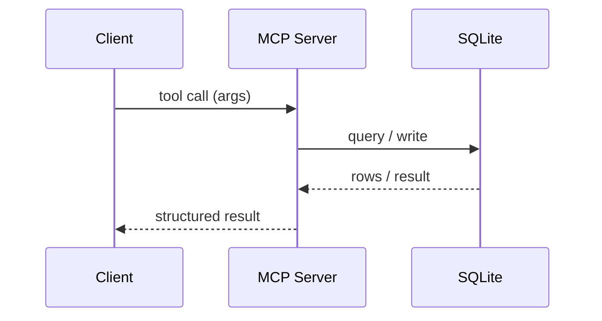

# Architecture Docs & Diagrams

Architecture documentation shows *how the system fits together* — the structure ADRs decide and the context index names, made visual. It is **living**: every diagram must match the code at all times, and a structural change updates its diagram in the same change (see `rules/maintenance-invariant.md`).

Diagrams are authored in **Mermaid** so they live in version control as text, diff cleanly in PRs, and render in most viewers — no binary image drift.

## Where it lives (CLI-owned, ADR 0036)

Views are registry records in `docs/architecture/`, scaffolded and indexed by the CLI —
one file per concern, never a single mega-file:

```bash
living-docs write new view "Context" --kind context     # docs/architecture/context.md
living-docs write new view "Backends" --kind container
living-docs manage index view                            # regenerates architecture/index.md
```

`--kind` seeds the CLI-validated `kind:` frontmatter from the closed vocabulary `context |
container | component | flow | sequence | state | data-model | deployment`; the generated
`architecture/index.md` sorts rows in that C4/arc42 zoom order (kind rank, then filename),
so the index reads outside-in without hand-maintenance. The docs-handwrite hook covers
`architecture/` exactly like the numbered type directories: records are born via `write new
view`, the index via `living-docs manage index`, and only the body below the closing `---` is
hand-edited. Views carry no status and are never superseded — they are living documents
updated in place; git history is the trail.

The architecture index (`index.md`, OKF reserved listing, no frontmatter) is reachable from the bundle-root `docs/index.md`. Each view file is a standalone **OKF concept** (`type: Architecture View`): frontmatter, then a single `#` H1, then `##` sections. A legacy single `docs/architecture.md` is brought current by re-creating each of its diagrams as a view record.

## The standard views

Cover the views the system actually has — don't invent diagrams for their own sake. Common ones:

| `--kind` | View | Mermaid type | Answers |
|---|---|---|---|
| `context` | **Context / high-level** | `flowchart` / `graph` | What are the major components and how do they connect to the outside world? |
| `container` | **Containers** | `flowchart` | What deployable/runnable pieces exist and how do they talk? (C4 level 2) |
| `component` | **Module layout** | `flowchart` | How is the code organized into modules and what depends on what? |
| `flow` | **Process / data flow** | `flowchart` with direction | How does data move through a key operation (ingest, backfill, request)? |
| `sequence` | **Tool-calling / request flow** | `sequenceDiagram` | How does a request actually execute across actors over time? |
| `state` | **State** | `stateDiagram-v2` | What states does an entity move through? (lifecycles, retention) |
| `data-model` | **Data model** | `erDiagram` | What entities exist and how do they relate? (schema, FKs, cardinality) |
| `deployment` | **Deployment** | `flowchart` | Where does each container run and over what infrastructure? |

## Per-view instrument binding (which views are checked vs inspection)

"Living — must match code" is only real for a view that has an instrument keeping it honest; the rest rely on the no-drift discipline (inspection), which a constraint-without-an-instrument is a vibe. State, per view, how drift is caught — and prefer a deterministic check where one exists:

| View | Drift caught by | Kind |
|---|---|---|
| **Module layout** | a **dependency-conformance check** if your project has one (ArchUnit · dependency-cruiser · Deptrac · import-linter) on a committed ruleset | deterministic |
| **Data model** | a schema/migration diff or ORM-schema check, where one exists | partial |
| **Module / component** | **distill-from-code** where an oracle exists — generate the view from the dependency graph rather than hand-drawing it, so it cannot drift from the imports it depicts (recipe: *Generated views*) | deterministic where wired |
| **Process / sequence / state** | the no-drift maintenance rule (review/inspection) — no deterministic oracle, except a state diagram exported by a declarative state-machine library (recipe: *Generated views*) | inspection |

Where a deterministic oracle exists, **prefer distilling the view from code** over hand-drawing it; reserve inspection for the views that genuinely have no oracle (the judgement residue), and say so per view rather than asserting "must match code" uniformly. A structural conformance rule SHOULD link back to the **ADR** that motivated it (the rule's ADR is its provenance; the ADR's fitness function is its instrument — `rules/adr-conventions.md` rule 6).

## Generated views (extractor + CI)

A view whose kind has a code oracle can have its diagram generated by the project's own extractor and kept fresh by a CI job; the `living-docs` binary stays unchanged and runs no extractor (tool and judgment work runs outside it).

The generated part of the view body sits between the line `<!-- generated by: <command> -->` and the line `<!-- end generated -->`, with the extractor command written in the first marker; everything outside the markers is hand-owned prose. Keep both markers outside the ` ```mermaid ` fence: the region holds the opening fence line, the extractor's Mermaid text and the closing fence line, so `check` sees a fenced diagram and never parses a marker as Mermaid. The binary does not read the markers. The generated part is written only by the named command, never edited by hand: a fix goes into the extractor's configuration or the declared mapping, then the command reruns.

Only some kinds have a code oracle: `component` (module layout) from an import graph, and `data-model` from a schema. The kinds `context`, `container`, `sequence`, `state`, `flow` and `deployment` have no import-graph or schema oracle and stay hand-authored (inspection, as in the table above); where a declarative state-machine library is in use, it may export a `state` diagram the same way. Pick an extractor your stack already has: dependency-cruiser or deptrac emit Mermaid natively; cargo-modules (Rust) emits DOT, which a script must convert; tbls renders a schema to Mermaid and has a `diff` command for CI. Sort node and edge order in what you write into the region, so a rerun on unchanged code yields no diff.

The CI job in the project's pipeline:

1. Run the extractor.
2. Rewrite only the region between the markers: the opening ` ```mermaid ` line, the extractor's output, and the closing fence line.
3. Run `living-docs check`: the view must stay a valid record and its Mermaid must parse. `check` validates Mermaid through merman-core, which can accept a diagram mermaid.js rejects (issue 0051), so render a new extractor's output once on the target host before relying on the job.
4. Run `git diff --exit-code` on the view file; any diff fails the job, because the committed diagram no longer matches the code. The fix is to commit the regenerated view.

Limits: the job runs in the project's CI, never in `living-docs check` or the pre-commit hook, since both must not depend on an installed extractor. `check` validates the Mermaid but cannot prove it matches the code; the CI diff does. As a rough heuristic, a graph over about 25 nodes is hard to read as drawn: group nodes into components by a declared path-to-component mapping before rendering, and keep automatic clustering out of the default path.

## Completeness checklist (arc42 / C4 / ISO-42010 as vocabulary, not a new index)

The bundle's *index* stays as defined above. Borrow the established frameworks only as a **completeness checklist + shared vocabulary** — not a competing layout: does the architecture cover context/scope, building-block (container/component) structure, runtime/dynamic behavior, deployment, cross-cutting concepts, the decision trail (ADRs), **quality requirements / NFRs** (the quality-attribute scenarios — see `rules/prd-conventions.md`), risks, and glossary? Use **C4** levels (context → container → component) as the zoom vocabulary for the structural views, and **ISO-42010**'s concern→view traceability as the discipline that every stakeholder concern is framed by at least one view. Adopt the names and the checklist; do not import arc42's 12-section template as a parallel index — the existing index, typed views, and ADRs already cover it. Provenance (instrumentalized, not invented): arc42 (STARKE; HRUSCHKA), C4 (BROWN), ISO/IEC/IEEE 42010, Views-and-Beyond (CLEMENTS et al., SEI).

## Tool-calling / sequence diagrams (when applicable)

When the system's behaviour is best understood as a *conversation between actors over time* — an MCP/tool call, an agent invoking tools, a client→server→DB round trip — use a `sequenceDiagram` to make the flow concrete. Show the actors as participants and each call/return as a message. This is the clearest way to evidence "how it actually works" for tool-driven or multi-actor systems.



Include a sequence diagram only where it earns its place — a tool surface, a lifecycle with ordering, a non-obvious multi-step flow. Skip it for trivially linear calls.

## Rules

1. **Mermaid, in-repo, text.** No exported PNG/SVG that can silently drift from the code.
2. **No-drift.** A change to schema, data flow, module layout, or a component relationship updates the relevant diagram(s) in the *same* change. A structural PR with a stale diagram is incomplete.
3. **Use context-index vocabulary.** Name nodes and participants with the project's domain/module terms, not ad-hoc labels — diagrams and prose must agree.
4. **One view per diagram.** Don't cram the data model and the request flow into one graph. Split by concern; index each.
5. **Indexed.** Every view file is listed in the architecture index, which is listed in the top-level Docs index.

## Anti-patterns

- A diagram that contradicts the code — worse than no diagram, because it misleads with authority.
- Screenshot/exported-image diagrams that can't diff and rot immediately.
- A single mega-diagram trying to show everything at once.
- Diagrams added but never wired into the index (orphans).
